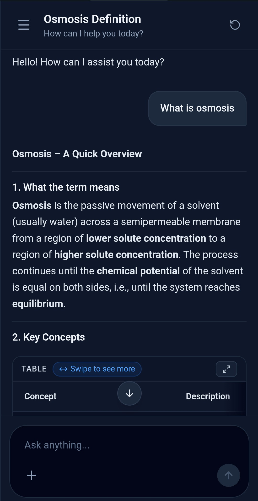

# AI Chat App 🤖💬

A full-stack, real-time AI chat application powered by the **Groq API**, built with **React + TypeScript** on the frontend and **Node.js + Express** on the backend. Conversations are persisted in a **PostgreSQL** database (hosted on Supabase), and the entire app is deployed on **Vercel**.

Users can send messages, receive streamed AI responses token-by-token, manage multiple named conversations, rename or delete chats, and pick up right where they left off — all in a sleek, dark-themed UI.

---

## 🖥️ Desktop Preview


The desktop layout features a persistent sidebar on the left that lists all saved conversations, alongside the main chat panel. Each conversation is auto-titled from the first user message and updates in real-time. The header displays live token usage (prompt, completion, and total tokens) for the active response. The input bar sits fixed at the bottom with a stop-generation button that appears while the AI is streaming, and a floating scroll-to-bottom button appears when the user scrolls up through long conversations.

---

## 📱 Mobile Preview



On mobile, the sidebar is hidden by default and slides in as an overlay panel triggered from the header menu button. A dark backdrop dims the chat area while the sidebar is open, and tapping outside it closes it. The chat layout adapts cleanly to small screens with compact padding, ensuring the input and messages remain usable on all screen sizes.

---

## 🚀 Live Demo

👉 https://ai-chat-app-green-three.vercel.app/

---

## ✨ Features

- 🔴 **Real-time streaming** — AI responses stream token-by-token via Server-Sent Events (SSE)
- 🛑 **Stop generation** — Abort an in-progress AI response instantly
- 💾 **Persistent chat history** — All conversations and messages saved to PostgreSQL
- 🗂️ **Conversation management** — Create, rename, delete, and switch between multiple chats
- 🏷️ **Auto-titling** — Conversations are automatically named from the first user message
- 📊 **Token usage display** — Live prompt, completion, and total token counts shown in the header
- 📱 **Responsive design** — Mobile-first layout with slide-in sidebar and overlay backdrop
- 📝 **Markdown rendering** — AI responses render full Markdown including tables, code blocks, and GFM
- ⬇️ **Scroll-to-bottom button** — Floating button appears when scrolled up in a long conversation
- 🔄 **Animated transitions** — Smooth fade-in between conversations using Framer Motion
- 🧠 **Structured output** — Dedicated endpoint for JSON-schema-validated AI responses via Zod
- ⚡ **Optimistic UI updates** — Chat title and conversation list update immediately before server confirmation

---

## 🛠️ Tech Stack

### Frontend
- **React 19** — UI library with concurrent features
- **TypeScript** — Static typing across the entire frontend
- **Vite** — Lightning-fast dev server and bundler
- **Tailwind CSS v4** — Utility-first styling
- **Zustand** — Lightweight global state management
- **Framer Motion** — Animation and transition library
- **React Markdown + remark-gfm** — Markdown rendering with GitHub Flavored Markdown support
- **Lucide React** — Icon library
- **eventsource-parser** — SSE stream parsing on the client

### Backend
- **Node.js** — JavaScript runtime
- **Express** — HTTP server and routing
- **TypeScript** — Static typing on the server
- **Groq SDK** — Groq API client for LLM inference with streaming
- **Zod** — Runtime request validation and structured output schemas
- **zod-to-json-schema** — Converts Zod schemas to JSON Schema for structured AI output

### Database
- **PostgreSQL** — Relational database for chat and message persistence
- **Supabase** — Managed PostgreSQL hosting with SSL certificate auth
- **node-postgres (`pg`)** — PostgreSQL client and connection pool

### Security & Infrastructure
- **Helmet** — Sets security-focused HTTP response headers
- **CORS** — Allowlist-based origin control (localhost + production client)
- **express-rate-limit** — Per-minute (10 req) and daily (100 req) rate limiting
- **dotenv** — Environment variable management
- **Vercel** — Deployment platform for both the Vite frontend and Express backend (monorepo rewrites)

---

## 🧠 Code Concepts Practised

### Frontend

- Global state management with **Zustand** (actions, selectors, derived state)
- **Custom React hooks** — `useChat`, `useChatScroll`, `useChatStreamController` for clean separation of concerns
- **SSE (Server-Sent Events) stream consumption** using `eventsource-parser` and `ReadableStream` reader
- **AbortController** for cancelling in-flight fetch requests (stop generation)
- **Optimistic UI updates** — updating store state before awaiting server confirmation
- **`useCallback`** and **`useRef`** for stable references and performance optimization
- **Conditional rendering** — loading skeletons, error states, empty states, and streaming indicators
- **Component composition** — breaking UI into focused, reusable components with typed props
- **Scroll management** — programmatic scroll-to-bottom, scroll threshold detection via `useEffect`
- **Animated page transitions** with Framer Motion (`motion.div`, opacity keyframes)
- **Responsive layout** — Tailwind mobile-first classes, fixed/static sidebar toggle
- **Markdown rendering** in chat with `react-markdown` and `remark-gfm` plugins
- **Type-safe API layer** — `chatApi.ts` and `chatStream.ts` with shared TypeScript interfaces

### Backend

- **RESTful API design** with Express — modular routes, controllers, and services
- **Streaming HTTP responses** using SSE (`text/event-stream`) with chunked transfer
- **Groq API integration** — streaming chat completions with token usage tracking
- **Structured output** — JSON schema enforcement via `zod-to-json-schema` and `response_format`
- **Request validation** with Zod `safeParse` — rejects malformed or oversized payloads before they hit the LLM
- **Controller/Service pattern** — `chat.controller.ts` orchestrates logic while `chatDb.service.ts` owns all DB queries
- **Health-check endpoint** (`/api/health`) for deployment verification
- **Environment configuration** with `dotenv` and runtime guards for missing secrets
- **Modular project structure** — routes, controllers, services, schemas, and middleware in separate folders

### Database

- **Relational schema design** — `chats` and `messages` tables with a foreign-key relationship
- **UUID primary keys** using PostgreSQL `gen_random_uuid()`
- **Cascading deletes** — `ON DELETE CASCADE` automatically removes messages when a chat is deleted
- **Role constraint** — `CHECK (role IN ('user', 'assistant', 'system'))` enforces valid message roles at the DB level
- **Timestamped records** — `created_at` and `updated_at` with `DEFAULT NOW()`
- **Index on `chat_id`** for fast message retrieval by conversation (`idx_messages_chat_id`)
- **Connection pooling** with `pg.Pool` — `max: 5`, `idleTimeoutMillis`, `connectionTimeoutMillis`
- **SSL/TLS database connections** — CA certificate verification for Supabase remote connections
- **Parameterised queries** — all queries use `$1, $2, ...` placeholders to prevent SQL injection
- **Aggregation queries** — `COUNT(m.id)` with `LEFT JOIN` and `GROUP BY` for message counts per conversation

### Security

- **HTTP security headers** via **Helmet** — `X-Content-Type-Options`, `X-Frame-Options`, `Strict-Transport-Security`, CSP, and more
- **Allowlist-based CORS** — only `localhost:5173` and the production client URL are permitted; all other origins are silently blocked
- **Rate limiting** — 10 requests/minute per IP (`express-rate-limit`) and a 100 requests/day daily cap to prevent LLM abuse
- **Input validation & length limits** — Zod enforces max 10,000 characters per message and max 100 messages per request
- **SQL injection prevention** — exclusively parameterised PostgreSQL queries via `pg`
- **SSL certificate pinning** — `rejectUnauthorized: true` with a pinned CA certificate for the Supabase DB connection
- **Secret management** — API keys and DB URLs are stored exclusively in `.env` files, never committed to source control
- **Request body size limit** — Express configured with a `2mb` JSON payload cap to prevent large-body attacks

---

## 📂 Project Structure

```text
AI Chat App/
├── database/
│   └── schema.sql
├── public/
├── server/
│   ├── certs/
│   │   └── prod-ca-2021.crt
│   ├── controllers/
│   │   ├── chat.controller.ts
│   │   └── conversation.controller.ts
│   ├── db/
│   │   └── pool.ts
│   ├── middleware/
│   │   └── rateLimiter.ts
│   ├── routes/
│   │   ├── chat.routes.ts
│   │   └── conversation.routes.ts
│   ├── schemas/
│   │   ├── chat.schema.ts
│   │   ├── conversation.schema.ts
│   │   └── person.schema.ts
│   ├── services/
│   │   ├── chatDb.service.ts
│   │   └── groq.service.ts
│   ├── package.json
│   ├── server.ts
│   └── tsconfig.json
├── src/
│   ├── components/
│   │   ├── chat/
│   │   │   ├── ChatInput.tsx
│   │   │   ├── ChatMessage.tsx
│   │   │   ├── MarkdownTable.tsx
│   │   │   ├── ScrollButton.tsx
│   │   │   └── Sidebar.tsx
│   │   └── ui/
│   │       ├── DeleteModal.tsx
│   │       ├── Header.tsx
│   │       └── IconButton.tsx
│   ├── hooks/
│   │   ├── useChat.ts
│   │   ├── useChatScroll.ts
│   │   └── useChatStreamController.ts
│   ├── Images/
│   │   ├── Desktop pic.png
│   │   └── Screenshot_20261106-102140~2.jpg
│   ├── services/
│   │   ├── chatApi.ts
│   │   └── chatStream.ts
│   ├── stores/
│   │   └── chatStore.ts
│   ├── types/
│   │   └── chat.ts
│   ├── App.css
│   ├── App.tsx
│   ├── index.css
│   └── main.tsx
├── .env
├── eslint.config.js
├── index.html
├── package.json
├── tsconfig.app.json
├── tsconfig.json
├── tsconfig.node.json
├── vercel.json
└── vite.config.ts
```
